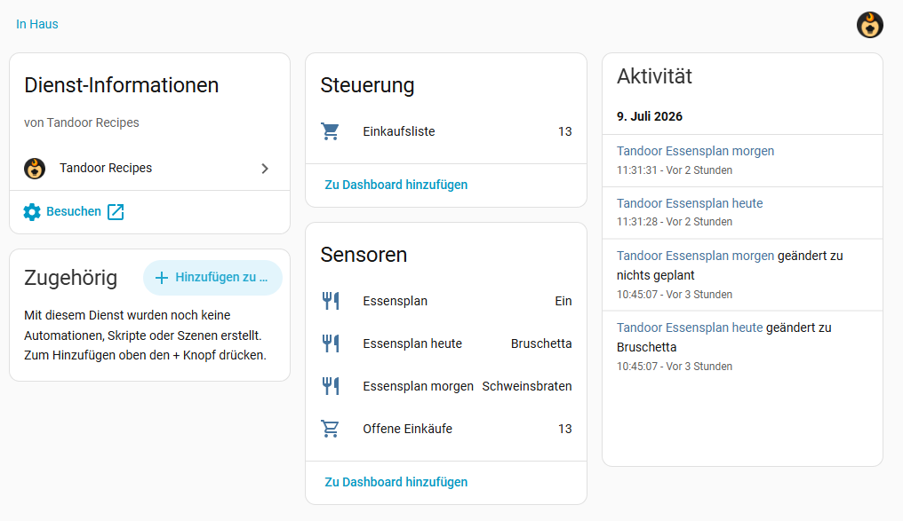
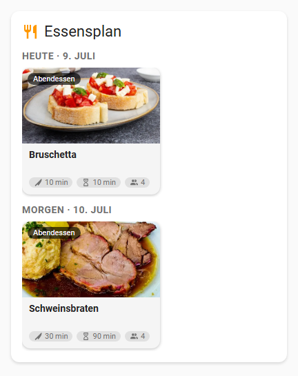

<p align="center">
  
</p>

# Tandoor Recipes for Home Assistant

Unofficial Home Assistant integration for [Tandoor Recipes](https://github.com/TandoorRecipes/recipes) — bringing your shopping list and meal plan into Home Assistant, similar to what the core Mealie integration offers.

## Features

| Entity | Type | Description |
|---|---|---|
| Shopping list | `todo` | The Tandoor shopping list as a native to-do entity. Add, check off, rename and delete items — changes sync back to Tandoor. Leading amounts are parsed (`2 Onions` → amount 2, food *Onions*). |
| Meal plan | `calendar` | Your Tandoor meal plan as a calendar with all-day events (`Dinner: Goulash`). |
| Meal plan today | `sensor` | Names of today's planned meals. Carries a `days` attribute with the full next 7 days (name, meal type, servings, image, recipe URL, working/waiting time) — ideal for dashboard cards. |
| Meal plan tomorrow | `sensor` | Names of tomorrow's planned meals. |
| Open shopping items | `sensor` | Number of unchecked shopping list entries. |
| Kochliste | `sensor` | Optional: cooking backlog of the Essensplan website (not Tandoor) — see [Kochliste](#kochliste-essensplan-website-companion). |

Polling intervals: shopping list every 60 s, meal plan every 5 min.



## Installation

### HACS (recommended)

[](https://my.home-assistant.io/redirect/hacs_repository/?owner=FragForward&repository=ha-tandoor&category=integration)

Or manually:

1. In HACS, open the three-dot menu (top right) → **Custom repositories**
2. Repository: `https://github.com/FragForward/ha-tandoor` — Type: **Integration** → **Add**
3. Search for **Tandoor Recipes** in HACS, open it and click **Download**
4. Restart Home Assistant (Settings → System → Restart)

### Manual

Copy the `custom_components/tandoor/` folder into your Home Assistant `config/custom_components/` directory and restart Home Assistant.

## Setup

[](https://my.home-assistant.io/redirect/config_flow_start/?domain=tandoor)

1. **Create an API token in Tandoor:** click your user avatar (top right) → **Settings** → tab **API** → **New token**, scope `read write`. Copy the token (`tda_...`).
2. In Home Assistant go to **Settings → Devices & Services → Add Integration** and search for **Tandoor Recipes** (or use the button above).
3. Enter:
   - **URL** — the base URL of your Tandoor instance as you open it in the browser, e.g. `http://192.168.1.4:9926` (no trailing slash needed)
   - **API token** — the token from step 1
4. Click **OK** — the integration validates the connection and creates the device with all entities.

## Lovelace card

The integration ships a dashboard card that renders the meal plan with recipe images, meal type chips, working/waiting times and servings — clickable through to the recipe in Tandoor.



The card has a full visual editor (entity picker, days to show, max meals per day, display toggles) and appears in the dashboard card picker.

**No manual installation needed** — the card is served and registered automatically by the integration. Just add it to any dashboard:

```yaml
type: custom:tandoor-mealplan-card
entity: sensor.tandoor_meal_plan_today   # your "Meal plan today" sensor
days_to_show: 2
```

Options: `title`, `days_to_show` (1–7), `show_image`, `show_times`, `clickable`, `hide_empty_days`.

Note: the recipe images are loaded directly from your Tandoor instance, so the browser needs to be able to reach the Tandoor URL.

## Kochliste (Essensplan website companion)

Since v0.5.0 the integration can additionally show and operate the **Kochliste**
(cooking backlog) of the family *Essensplan* website — a small companion API
that is **not part of Tandoor** (`http://<essensplan-host>/api.php`, no auth).

**Setup:** open the integration's **Configure** dialog (options) and set the
**Essensplan URL** (default `http://192.168.1.4:8091`). Leave it empty to
disable the feature. If the API is unreachable the integration keeps working
as before — the Kochliste sensor just becomes unavailable and recovers
automatically (polled every 60 s).

**Entity:** `sensor.tandoor_kochliste` — state is the number of recipes not
yet cooked; attributes `rezepte` (full list: `id`, `titel`, `recipe_id`,
`bild`, `quelle`, `status` = `einkaufen`/`kochbar`/`gekocht`, `hinzugefuegt`,
`gekocht_am`) and `batch`.

**Card:** the bundled `custom:tandoor-kochliste-card` (registered by the same
JS module, no extra resource needed) lists all open recipes with a round
recipe image, a status chip (🛒 *einkaufen* = dimmed/orange, *kochbar* =
normal) and:

- a green **Gekocht ✓** button on cookable recipes — confirms, calls
  `tandoor.kochliste_gekocht` and then opens a **star rating popup**
  (5 stars + optional comment → `tandoor.kochliste_bewerten`; skipped for
  free-text entries without a Tandoor `recipe_id`),
- an **Einkaufsliste** link on shopping-state recipes that opens
  `<essensplan_url>/einkauf.php`,
- optionally the recipes cooked in the last days as a small ✓ list.

```yaml
type: custom:tandoor-kochliste-card
entity: sensor.tandoor_kochliste   # optional, auto-detected
title: Kochliste
essensplan_url: http://192.168.1.4:8091   # for the shopping list link
show_gekocht: true      # show recently cooked recipes
gekocht_tage: 3         # ... of the last N days
confirm_gekocht: true   # ask before marking as cooked
```

**Services** (all refresh the Kochliste sensor afterwards):

| Service | Fields | Effect |
|---|---|---|
| `tandoor.kochliste_gekocht` | `id` (e.g. `k7`) | Marks the item as cooked; the website also creates today's meal plan entry in Tandoor. |
| `tandoor.kochliste_kochbar` | `id` | Moves the item from *einkaufen* to *kochbar*. |
| `tandoor.kochliste_bewerten` | `recipe_id`, `sterne` (0–5, 0 = delete), `kommentar` (optional) | Stars + comment for the Tandoor cook log. |

## Shopping list → Bring! / other apps

Want Tandoor shopping list entries to end up in another list app (e.g. **Bring!**)?
**→ [Node-RED sync guide](docs/nodered-bring-sync.md)** — transfers each entry with the
amount as description and keeps the Tandoor list empty. This is the recommended setup.

Alternatively Tandoor's built-in *Connector* can push entries itself (no Node-RED, but
one-way, amount in the title, source list never cleared) — see [connector guide](docs/connector.md).

## Good to know — Tandoor features that pair well

Features of **Tandoor itself** (not of this integration) that make the shopping list nicer: foods flagged *ignore shopping* in Tandoor (salt, water, …) never reach the shopping list, and Tandoor's *food alias* automations keep ingredient naming consistent across imported recipes.

## Disclaimer

This is a third-party integration, not affiliated with the Tandoor project. Tested against Tandoor 2.x.

**AI disclaimer:** the code, card and documentation in this repository were largely
generated with an AI assistant (Claude) and have not been further audited by hand.
The integration only communicates with your own Tandoor instance; the API token is
stored in Home Assistant's config entry storage (standard HA practice) and there are
no third-party dependencies. Review the code before use if you have elevated security
requirements, and report anything odd via the issue tracker.

## License

[MIT](LICENSE)
